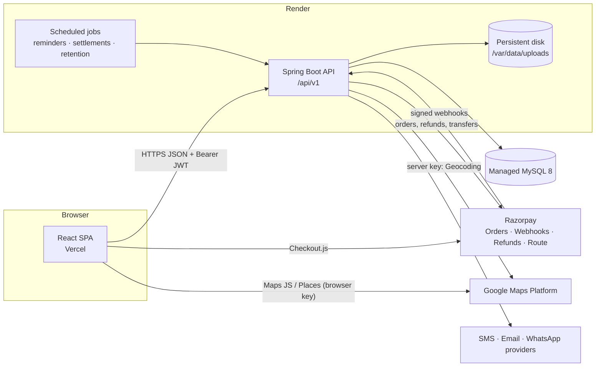

# BookEasy Architecture

## System overview



## Repository layout

```
booking/
├── backend/                  Spring Boot 3.5 · Java 17 · Maven wrapper
│   ├── src/main/java/com/bookeasy/
│   │   ├── common/           api envelope, exceptions, security, config (shared by all modules)
│   │   ├── audit/            append-only audit log
│   │   ├── platform/         platform & support settings
│   │   ├── system/           health
│   │   └── <module>/         one package per business module (auth, user, organization, category,
│   │                         catalog, staff, availability, appointment, payment, review,
│   │                         notification, location, support, file, admin)
│   │       ├── controller    REST endpoints, DTO in/out only
│   │       ├── service       business rules + @Transactional boundaries + authorization checks
│   │       ├── repository    Spring Data JPA
│   │       ├── entity        JPA entities (never serialised to clients)
│   │       └── dto           request/response records with Bean Validation
│   └── src/main/resources/db/migration   Flyway migrations (schema source of truth)
├── frontend/                 React 18 · TypeScript · Vite · Tailwind · React Router 7 · TanStack Query · i18next
│   └── src/
│       ├── components/       ui/ (design system), brand/, common/
│       ├── layouts/          Public, Customer, Owner, Staff, Admin shells
│       ├── pages/            route-level screens
│       ├── features/<module>/ module-specific components & hooks
│       ├── services/         API client + typed per-module API functions/hooks
│       ├── contexts/         theme, auth, location
│       ├── routes/           route table + role guards
│       ├── i18n/             en, ta, hi, ml, te, kn
│       ├── utils/  hooks/  styles/
├── docs/                     architecture, schema, integrations, deployment, checklist
├── .env.example              every configurable value, no secrets
└── render.yaml               Render blueprint (backend + persistent disk)
```

## Key decisions

| Topic | Decision | Why |
|---|---|---|
| API style | REST under `/api/v1`, every response wrapped in `{success, data, error, timestamp}` | One error shape for the frontend; `error.code` maps to translated messages |
| Schema ownership | Flyway migrations; Hibernate `ddl-auto=validate` | Reviewable, repeatable schema changes; app refuses to start if entities drift |
| Time | JVM, JDBC session and Jackson all in UTC; `DATETIME(6)` columns hold UTC instants; organisation wall-clock rules (`TIME`, `DATE`) are interpreted in the branch's timezone (default `Asia/Kolkata`) | Avoids double conversion; found and fixed an IST shift bug during Phase 1 tests |
| Money | `DECIMAL(12,2)` in MySQL, `BigDecimal` in Java, `RoundingMode.HALF_UP` to 2 dp; frontend only formats | No floating-point money |
| Auth | Short-lived access JWT (Bearer header) + rotating refresh token in an `HttpOnly; Secure; SameSite` cookie scoped to the refresh endpoint, stored hashed in `refresh_tokens` | Access token not persisted in JS storage; refresh token theft detectable via rotation |
| Authorization | URL rules in `SecurityConfig` for coarse role gates **plus** ownership checks in services (`owner owns org`, `staff assigned to branch`, `customer owns booking`) | Prompt requires tenant isolation; never relies on hidden UI |
| Double booking | Booking transaction locks the staff/resource row (`SELECT … FOR UPDATE`) and inserts one `appointment_slot_locks` row per slot unit with a `UNIQUE(resource_key, slot_start)` constraint | Database guarantees no overlap even under concurrent requests or multiple API instances |
| Payments | Server creates Razorpay orders; success only after signature verification **or** a verified webhook; webhook events de-duplicated by `UNIQUE(event_id)` | Never trust the browser |
| Files | `FileStorage` interface; `LocalDiskFileStorage` now (Render persistent disk), S3 later. Private files streamed through authorised endpoints only | Verification documents are never publicly addressable |
| Notifications | Outbox table + scheduled dispatcher with per-channel provider adapters | Reliable retries, delivery logs, no frontend timers |
| i18n | Translation JSON per language; backend returns error *codes*; notification templates stored per language | All six languages without hardcoded strings |

## Security baseline (implemented in Phase 1)

- Stateless Spring Security chain, deny-by-default (`anyRequest().authenticated()`), JSON 401/403.
- CORS restricted to `CORS_ALLOWED_ORIGINS`; unknown origins get 403.
- Security headers: `X-Content-Type-Options`, `X-Frame-Options`, CSP `frame-ancestors 'none'`, strict referrer policy; HSTS is added by Spring Security on HTTPS.
- Error responses never include stack traces or exception messages.
- BCrypt (cost 12) password encoder bean ready for Phase 2.
- Secrets only from environment; root `.env` is git-ignored.
- Swagger UI off by default in `prod`.
