# BookEasy Database Design (MySQL 8, InnoDB, utf8mb4)

Status legend: **✅ migrated** · ⏳ designed, migration lands in the phase noted.

Conventions
- `BIGINT AUTO_INCREMENT` surrogate keys; public identifiers (booking reference, QR token) are separate random columns.
- `created_at` / `updated_at` as `DATETIME(6)` holding **UTC**. Wall-clock rules (`working_hours`, `holidays`) use `TIME`/`DATE` interpreted in the branch `timezone`.
- Money: `DECIMAL(12,2)` rupees. Percentages: `DECIMAL(5,2)`.
- Status columns are `VARCHAR` + `CHECK` constraints (easier to evolve than `ENUM`).
- Soft-delete only where history matters (`deleted_at`); financial rows are never deleted.
- Every tenant-owned row carries `organization_id` (and `branch_id` where relevant) for cheap ownership filters.

## Entity relationships (core)

```mermaid
erDiagram
  users ||--o{ user_roles : has
  roles ||--o{ user_roles : grants
  users ||--|| user_profiles : has
  users ||--o{ user_addresses : saves
  users ||--o{ family_members : manages
  users ||--o{ organization_owners : owns
  organizations ||--o{ organization_owners : "owned by"
  categories ||--o{ subcategories : contains
  subcategories ||--o{ organizations : classifies
  categories ||--o{ category_document_requirements : requires
  organizations ||--o{ organization_documents : submits
  organizations ||--o{ organization_verifications : "reviewed in"
  organizations ||--o{ organization_branches : has
  organization_branches ||--o{ working_hours : opens
  organization_branches ||--o{ holidays : closes
  organizations ||--o{ services : offers
  services ||--o{ branch_services : "offered at"
  organization_branches ||--o{ branch_services : offers
  users ||--o| staff_profiles : "is staff"
  staff_profiles ||--o{ staff_branches : "works at"
  staff_profiles ||--o{ staff_services : performs
  staff_profiles ||--o{ staff_availability : available
  staff_profiles ||--o{ staff_leaves : "on leave"
  appointments }o--|| organization_branches : at
  appointments }o--|| services : for
  appointments }o--o| staff_profiles : with
  appointments }o--|| users : "booked by"
  appointments }o--o| family_members : "for member"
  appointments ||--o{ appointment_slot_locks : reserves
  appointments ||--o{ appointment_status_history : tracks
  appointments ||--o| appointment_cancellations : "cancelled by"
  appointments ||--o| appointment_checkins : "checked in"
  appointments ||--o{ payments : "paid via"
  payments ||--o{ payment_transactions : logs
  payments ||--o{ refunds : refunds
  payments ||--|| commissions : "earns"
  settlements ||--o{ settlement_items : contains
  appointments ||--o| reviews : reviewed
  reviews ||--o{ review_ratings : details
  reviews ||--o{ review_images : shows
  reviews ||--o| review_replies : "replied by owner"
  reviews ||--o{ review_reports : reported
```

## Phase 1 — Platform foundation ✅ (`V1__platform_foundation.sql`)

| Table | Purpose / key constraints |
|---|---|
| `roles` | `CUSTOMER`, `BUSINESS_OWNER`, `STAFF`, `SUPER_ADMIN`; `UNIQUE(code)` |
| `platform_settings` | typed key/value (`commission.percent=5.00`, `retention.booking_history_years`, locales …); `is_public` decides what `/public/config` exposes |
| `support_settings` | single row (`CHECK id=1`); email/phone `NULL` until admin sets real values |
| `audit_logs` | append-only; actor, action, entity, JSON details, IP; indexes on entity, actor+time, time |

## Phase 2 — Authentication ✅ (`V2__authentication.sql`)

| Table | Key columns / constraints |
|---|---|
| `users` | `email UNIQUE NULL`, `phone_e164 UNIQUE NULL`, `CHECK (email OR phone)`, `password_hash NULL` (OTP/Google-only users), `status` (`ACTIVE/SUSPENDED/DELETED`), `email_verified_at`, `phone_verified_at`, `preferred_language CHECK in 6 codes`, `two_factor_enabled`, `two_factor_secret_enc` (AES-GCM), `two_factor_last_step` (replay guard), `failed_login_count`, `locked_until`, `token_version` (bump = revoke all access tokens) |
| `user_roles` | PK(`user_id`,`role_id`), cascade on user delete |
| `refresh_tokens` | `token_hash CHAR(64) UNIQUE`, `family_id`, `expires_at`, `revoked_at`, `replaced_by_id`, user agent, IP |
| `email_verifications` | `token_hash UNIQUE`, `email` (token dies if the address changes), `expires_at`, `used_at` |
| `password_reset_tokens` | `token_hash UNIQUE`, `expires_at`, `used_at` |
| `otp_verifications` | `phone_e164`, `purpose` (`LOGIN/VERIFY_PHONE`), `code_hash` (HMAC), `attempts`, `expires_at`, `consumed_at`; index (`phone_e164`,`purpose`,`created_at`) |
| `oauth_accounts` | `UNIQUE(provider, provider_subject)` |
| `rate_limit_counters` | PK(`bucket_key`,`window_start`), `hits` — shared fixed-window limiter |

Also adds FKs `platform_settings.updated_by` / `support_settings.updated_by` → `users` (SET NULL).
Extended profile data (photo, gender, DOB) lands in `user_profiles` with Phase 10 customer features.

## Phase 3 — Organizations, categories, verification ✅

| Table | Key columns / constraints |
|---|---|
| `categories` | `slug UNIQUE`, `name_i18n JSON`, icon/image file, `is_active`, `booking_workflow` (`HEALTHCARE/SALON/EDUCATION/GENERIC`), `filter_schema JSON`, `sort_order` |
| `subcategories` | FK category, `UNIQUE(category_id, slug)`, `name_i18n JSON`, `is_active` |
| `category_document_requirements` | FK category, `code`, `label_i18n JSON`, `is_mandatory`, allowed MIME types, max size |
| `organizations` | `subcategory_id`, `name`, `slug UNIQUE`, `description_i18n JSON`, logo file, contact, `verification_status` (`DRAFT/PENDING/APPROVED/REJECTED/SUSPENDED`), `confirmation_mode` (`INSTANT/APPROVAL`), `rating_avg DECIMAL(3,2)`, `review_count`, bank details reference (`payout_account_id`, encrypted) |
| `organization_owners` | PK(`organization_id`,`user_id`), `role` (`PRIMARY/CO_OWNER`) |
| `organization_branches` | FK org, address lines, `city`, `locality`, `pincode CHAR(6)`, `latitude DECIMAL(9,6)`, `longitude DECIMAL(9,6)`, `location POINT SRID 4326 NOT NULL` + `SPATIAL INDEX`, `timezone`, `is_active` |
| `organization_documents` | FK org, `requirement_id`, `uploaded_file_id`, `status` (`SUBMITTED/ACCEPTED/REJECTED`), reviewer notes |
| `organization_verifications` | application history: submitted_at, decided_at, decided_by, decision, reason |
| `organization_images` | gallery, `sort_order` |
| `working_hours` | FK branch, `day_of_week TINYINT`, `opens_at`, `closes_at`, `break_start`, `break_end`; `UNIQUE(branch_id, day_of_week)` |
| `holidays` | FK branch (or org-wide), `date`, `reason`; `UNIQUE(branch_id, date)` |

Implemented in `V3__organizations.sql`, with these deliberate differences from the original plan:

- `organizations.description` is plain text in the owner's own language (owner-written content is not translated); categories, subcategories and document requirements keep `*_i18n` JSON.
- `organization_branches.location` is a **stored generated column** `ST_SRID(POINT(longitude, latitude), 4326)`, so it can never disagree with latitude/longitude. JPA does not map it. MySQL reads SRID 4326 points as (longitude, latitude) when built with `POINT(x, y)` this way; verified by `TenantIsolationIT`.
- `holidays` are per branch only; the UI applies them branch by branch.
- `uploaded_files` (planned for Phase 10) arrived now; `organization_images` (gallery) and the payout account reference are deferred (gallery later, payouts in Phase 8).
- `categories.filter_schema` exists but is not exposed until search filters land (Phase 6).
- `organizations.version` adds optimistic locking on top of the `SELECT … FOR UPDATE` taken by every state change.

## Phase 5 — Services, staff, availability ✅

Implemented in `V4__services_staff_availability.sql`. Differences from the plan: owner-written service names are plain text; `service_categories` and `slot_minutes` were dropped (each service has `slot_interval_minutes`); several availability windows per day are allowed; `staff_invitations` references the placeholder `staff_profiles` row.

| Table | Key columns / constraints |
|---|---|
| `service_categories` | per-organization grouping (e.g. "Consultations") |
| `services` | FK org, `name_i18n`, `description_i18n`, `duration_minutes`, `price DECIMAL(12,2) CHECK ≥ 0`, `consultation_type`, `requires_staff`, `buffer_minutes`, `max_advance_days`, `min_notice_minutes`, `is_active` |
| `branch_services` | PK(`branch_id`,`service_id`), optional branch price override |
| `staff_profiles` | 1:1 users, FK org, title (e.g. Dr.), specialisation, `permissions JSON` (`CAN_CONFIRM`, `CAN_CANCEL`, `CAN_EDIT_HOURS`), `is_active` |
| `staff_branches` · `staff_services` | join tables with composite PKs |
| `staff_availability` | weekly pattern per branch: `day_of_week`, `start_time`, `end_time`, `slot_minutes` |
| `staff_leaves` | `starts_at`, `ends_at` (UTC), reason |
| `staff_invitations` | `token_hash UNIQUE`, email/phone, expiry, accepted_at |

Slots are **computed** (working hours ∩ staff availability − breaks − holidays − leaves − existing locks), not pre-materialised.

## Phase 7 — Appointments ⏳

| Table | Key columns / constraints |
|---|---|
| `appointments` | `reference CHAR(14) UNIQUE` (e.g. `BE-7K3Q9X2M4P`, Crockford base32), `customer_user_id`, `family_member_id NULL`, `organization_id`, `branch_id`, `service_id`, `staff_id NULL`, `start_at`, `end_at` (UTC), `status` (`PENDING/CONFIRMED/REJECTED/CANCELLED/CHECKED_IN/IN_PROGRESS/COMPLETED/NO_SHOW/REFUND_PENDING/REFUNDED`), price snapshot (`service_fee`, `platform_fee`, `total_amount`, `commission_percent`), `payment_mode` (`ONLINE/PAY_AT_ORGANIZATION`), `version` (optimistic lock); indexes (`branch_id`,`start_at`), (`staff_id`,`start_at`), (`customer_user_id`,`start_at`) |
| `appointment_slot_locks` | `resource_key` (`staff:{id}` or `branch-service:{id}:{id}`), `slot_start` (granularity unit), FK appointment, **`UNIQUE(resource_key, slot_start)`** — the double-booking guard; rows deleted when the appointment is cancelled/rejected |
| `appointment_status_history` | from/to status, actor, reason, timestamp |
| `appointment_cancellations` | 1:1 appointment: reason, cancelled_by user+role, `requested_at` (server time), `minutes_before_start`, `refund_percent`, `deduction_amount`, `refund_amount`, `refund_status` |
| `appointment_checkins` | `UNIQUE(appointment_id)` (prevents duplicate check-in), staff, method (`QR/MANUAL`), timestamp |
| `appointment_qr_codes` | `token_hash CHAR(64) UNIQUE`; QR encodes only an opaque random token, never personal data |
| `appointment_reschedules` | old/new start, actor |

## Phase 8 — Payments, refunds, settlements ⏳

| Table | Key columns / constraints |
|---|---|
| `payments` | FK appointment, `provider_order_id UNIQUE`, `provider_payment_id UNIQUE NULL`, `amount`, `currency CHAR(3)='INR'`, `status` (`PENDING/PAID/FAILED/REFUND_PENDING/PARTIALLY_REFUNDED/REFUNDED/PAY_AT_ORGANIZATION`), `method`, `idempotency_key UNIQUE` |
| `payment_transactions` | every provider interaction (create order, verify, capture, webhook) with raw payload hash |
| `payment_webhook_events` | `provider_event_id UNIQUE` → duplicate webhooks are no-ops; signature-verified flag; processed_at |
| `commissions` | 1:1 payment: `service_amount`, `commission_percent`, `commission_amount` (5% of service fee), `business_amount` |
| `refunds` | FK payment, `provider_refund_id UNIQUE NULL`, `amount`, `status` (`PENDING/PROCESSED/FAILED`) — marked processed only from provider confirmation |
| `payout_accounts` | owner bank/Route linked-account reference (`provider_account_id`), masked account number only; full details held by Razorpay |
| `settlements` | per organization per day: gross, commission, refund adjustments, net payable, `provider_transfer_id`, `status` (`SCHEDULED/PROCESSING/SETTLED/FAILED`); `UNIQUE(organization_id, settlement_date)` |
| `settlement_items` | FK settlement + payment/refund, amount |
| `invoices` · `receipts` | sequential `number UNIQUE`, FK payment, PDF `uploaded_file_id` |

## Phase 9 — Reviews & notifications ⏳

| Table | Key columns / constraints |
|---|---|
| `reviews` | **`UNIQUE(appointment_id)`** (one per completed appointment), customer, org, staff, `overall_rating TINYINT CHECK 1–5`, text, `status` (`PUBLISHED/HIDDEN/REMOVED`) |
| `review_ratings` | PK(`review_id`,`aspect`) aspect ∈ `SERVICE_QUALITY/STAFF_BEHAVIOUR/CLEANLINESS/WAITING_TIME` |
| `review_images` · `review_replies` (`UNIQUE(review_id)`) · `review_reports` (`UNIQUE(review_id, reporter_id)`) | |
| `notifications` | in-app feed: user, type, title/body (rendered), `read_at` |
| `notification_preferences` | PK(`user_id`,`channel`,`event_type`), `enabled`, WhatsApp opt-in timestamp |
| `notification_templates` | `UNIQUE(event_type, channel, language)`, body with placeholders, provider template id (DLT / WhatsApp approved) |
| `notification_outbox` | pending messages, `attempts`, `next_attempt_at`, `dedupe_key UNIQUE` |
| `notification_delivery_logs` | provider message id, status, error |
| `reminder_configurations` | per org/branch offsets in minutes (default 1440, 60) |

## Phase 10 — Customer extras & admin ⏳

| Table | Key columns / constraints |
|---|---|
| `user_addresses` | label, address, city, pincode, lat/lng, `is_default` |
| `family_members` | FK user, name, relation, DOB, gender |
| `favorites` | PK(`user_id`,`organization_id`) |
| `saved_locations` | recent/preferred search locations |
| `comparison_history` | user, organization ids JSON, created_at |
| `uploaded_files` | *moved to Phase 3* (see above) |
| `support_requests` | customer, booking/payment reference, subject, status |
| `data_retention_runs` | archive/cleanup job audit |
